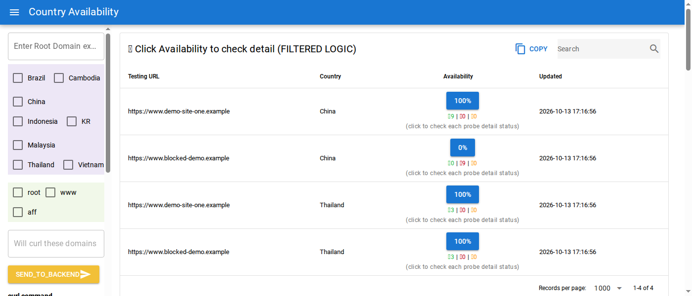
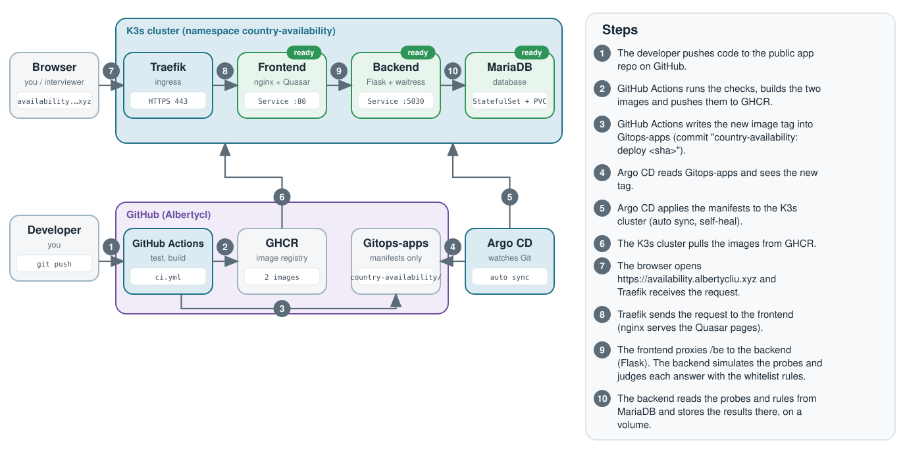

# Country-availability

**Live demo:** https://availability.albertycliu.xyz (made-up probes, no login)

A web tool that answers one question: "Can people in country X open this website right now?" Pick URLs and countries, and it shows the availability per country, for example "China 0%, Thailand 100%".



## What it does

- Asks probe servers in several countries to fetch each URL, then judges every answer with rules stored in a database (failure text, success marker, or "unknown").
- Shows the availability per country and the raw result of every probe, and can repeat the check every hour to keep a history.
- The probes are simulated (the real servers no longer exist). Try `https://www.blocked-demo.example` (fails from China) and `https://www.demo-site-one.example` (healthy) with China and Thailand selected.

## How it works



Code goes to GitHub, GitHub Actions builds the images and updates the [Gitops-apps](https://github.com/Albertycl/Gitops-apps) repo, and Argo CD deploys the change to a K3s cluster by itself.

## SRE skills this shows

- **GitOps and CI/CD:** GitHub Actions, GHCR, Argo CD with auto sync and self-heal.
- **Rollback:** `git revert` of the "country-availability: deploy" commit in Gitops-apps.
- **Containers:** one Dockerfile per component and a self-contained Docker Compose file.
- **Configuration:** the database password comes from an environment variable or a Kubernetes Secret, never from Git.
- **Kubernetes:** MariaDB StatefulSet with a volume, Traefik ingress with a Let's Encrypt certificate (cert-manager), readiness probes (health checks), resource requests and limits.
- **Testing without the real world:** a fake transport layer lets the real logic (rules, maths, scheduler) run with no remote servers.

## Run it locally

Needs Docker with the Compose plugin.

```bash
cp .env.example .env     # set DB_PASSWORD and DB_ROOT_PASSWORD
docker compose up --build
```

Then open `http://localhost:5440` and use the page `/filtered`. The database loads the demo data on its first start.

## Known limits

No login: the public demo is open on purpose because the probes are simulated and the data is made up. Add authentication before using real probes or data.

## More

[Full details](docs/DETAILS.md): install on Kubernetes, CI/CD, monitoring and known limits.
